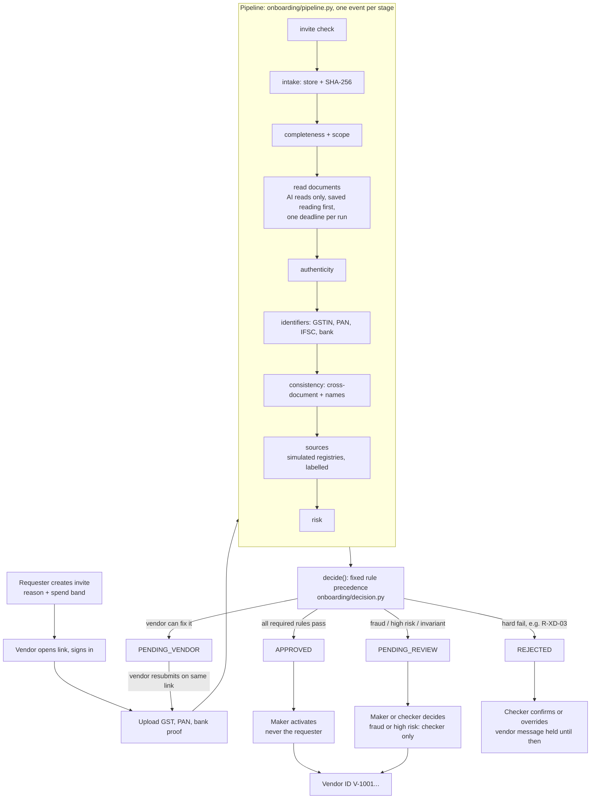

# Architecture (PS-2: vendor onboarding)

FastAPI + Jinja pages + SQLAlchemy (SQLite locally, Neon Postgres on Render). Checked against the code at the commit
this file was written; where `docs/REFACTOR_PLAN.md` and the code differ, the code wins (see the last section).

## The flow

## Module map (files that matter for PS-2)

| File | Role |
|---|---|
| `onboarding/main.py` | App, `/healthz`, `/readyz`, startup steps (each independent), demo-on-remote warning |
| `onboarding/config.py` | `Settings`, `require_secrets`, `reset_passcode` |
| `onboarding/web.py` | Invites, vendor form (`/apply/{token}`), launcher (`/demo/{key}`), run page and SSE stream, `run_action` (human actions), `/system` reset |
| `onboarding/portal.py` | Vendor register/login, staff login |
| `onboarding/pipeline.py` | `STAGES`, `run_pipeline`: runs the stages, emits events, optional pacing |
| `onboarding/runner.py` | Queues and runs pipelines in the background |
| `onboarding/ai/read.py` | The only AI call: `read_with_cache` (saved reading by SHA-256, deadline, never raises) |
| `onboarding/authenticity/` | File fingerprints, editor metadata, signature checks, proof level per document |
| `onboarding/validators.py`, `matching.py`, `names.py` | GSTIN/PAN/IFSC checks, field and name comparison |
| `onboarding/rules.py` | Every rule (R-INV, R-COMP, R-ID, R-BANK, R-XD, R-NAME, R-RISK, ...) as a pure result |
| `onboarding/sources.py` | Simulated GST/PAN/bank/CIN/Udyam registries (labelled), live IFSC |
| `onboarding/decision.py` | `decide()`, `grade()` (A0-A4), risk tier, vendor message and internal note |
| `onboarding/access.py` | Roles (sponsor, maker, checker) and what each may see |
| `onboarding/seeding.py`, `demo_data.py` | Cast, scenario invites, golden scenarios, reset |
| `onboarding/security.py` | Visitor address, rate limits, upload checks |

## Invariants

1. **Rules decide; AI only reads.** `onboarding/ai/read.py` returns document readings; `rules.evaluate` produces rule results; `decision.decide` turns them into a status with fixed precedence. The AI never sees what the vendor typed and never picks a status.
2. **Proof levels A0-A4** (`decision.LEVEL_NAMES`: Declared, Evidenced, Genuine, Cryptographically proven, Confirmed at source). `grade()` documents that simulated sources never raise a fact to A4; only a live lookup (the IFSC branch) can.
3. **"Couldn't read" is never "different".** An unreadable or partial value yields a re-upload request or a skipped check, not a mismatch (for example `rules.py`: `nleg in ("partial", "unreadable")` asks to re-upload). A failed reading falls back to the saved reading or asks for a clearer copy.
4. **Separation of duties.** In `web.py` the action table blocks the requester (and the `sponsor` role) from approve, activate or reject. High-risk or fraud-flagged cases need the Finance checker; only the checker can reject after review.
5. **Held messages.** `decision.vendor_state` is `sent`, `held` or `draft`; a rejection's vendor message is `held` until a person confirms. The internal note is separate and not shown to the vendor.
6. **Approval invariant.** If `decide()` would approve while a required rule (the `REQUIRED` set) did not pass, it returns PENDING_REVIEW with reason `INTERNAL-INVARIANT` and logs an error instead of approving. SKIPPED never counts as a pass.
7. **Demo parameter is not a bypass.** `?demo=` works only with `DEMO_TOOLS=true` and a known scenario; a guest may open an invite only if the launcher made it for that same scenario.

## Where the plan and the code differ
- Plan section 9 mentions `DATA_KEY` and `INDEX_KEY`; the code has only `INTEL_SECRET` (blank means `SESSION_SECRET`).
- The plan calls the reset "curated". The code reset (`seeding.seed(reset=True)`) drops every table and reseeds the demo cast and scenario invites.
- Feature flags (`FEATURE_*`) and `STAGE_PACE_SECONDS` are being added in parallel; they are documented in `docs/DEPLOY.md` but were not in `config.py` when this was written. `run_pipeline` already takes a `pace` argument.
