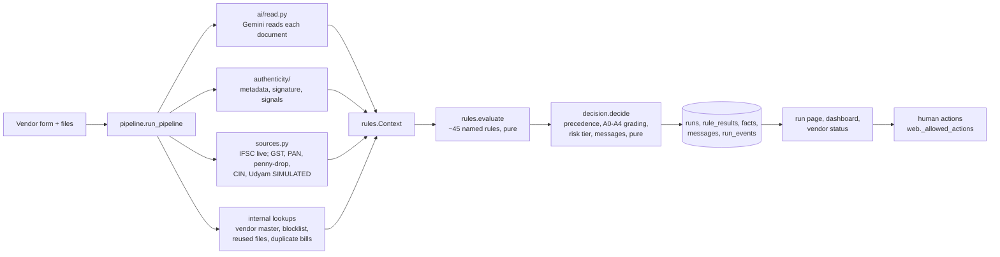
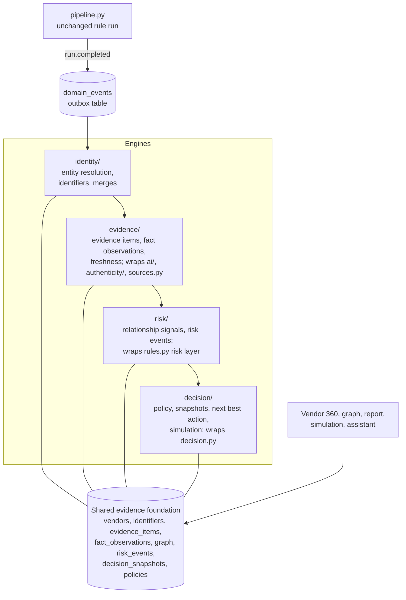

# Product evolution: from Vendor Onboarding to Vendor Intelligence

**Status:** proposal approved (Option A, 3 Nov 2026). **Milestone 1a and the M1b simulation are built and tested**: see section 13. Everything else here is still a proposal unless it says **(exists)**.
**Written:** 3 Nov 2026, after reading the whole repository (`onboarding/`, `tests/`, `scripts/`, `docs/HOW_IT_WORKS.md`, `../docs/PRODUCT.md`, `../docs/PLAN.md`).
**Rule for this document:** every capability is marked **Now** (buildable with what exists), **Simulated** (buildable, but only against the simulated registries, and labelled so) or **Needs integration** (needs a paid or contracted data source, a scheduler or a second organisation).

The goal in one line: **one vendor, one connected identity profile, one evidence-backed view of risk, one explainable decision process.**

---

## 0. Two corrections to the brief, and one timing constraint

1. **The front end does not use HTMX or Alpine.js.** It is Jinja2 templates, Tailwind (CDN) and a small amount of vanilla JavaScript, with Server-Sent Events for the live run view. This proposal keeps that. Nothing below needs HTMX or Alpine; a `fetch()` that swaps one fragment is enough for the simulation panel.
2. **There is no migration tool.** Tables are created with SQLAlchemy `create_all` at startup, which adds missing tables but never alters existing ones. So the first milestone is designed to be **purely additive** (new tables only), and Alembic is introduced before any existing table changes (section 9).
3. **Timing.** The case study's demo video is planned for 5 Nov and the submission is due 6 Nov. Milestone 1 as specified (six capabilities) is roughly two focused days of work, with regression risk to a demo that works today. Section 12 proposes a cut, and the decision is yours.

---

## 1. Current product architecture (exists)

### 1.1 Stack and deployment

| Layer | What is used |
|---|---|
| Web | FastAPI (Python 3.13), Jinja2 server-rendered pages, Tailwind via CDN, vanilla JS, SSE for the live run |
| Data | PostgreSQL on Neon (asyncpg, SQLAlchemy 2), SQLite for tests |
| AI | Gemini 3.5 Flash Lite (free tier: 15 requests a minute), with a saved-reading cache keyed by file SHA-256 |
| Hosting | Render free tier (Singapore, next to Neon); auto-deploys from `main` |
| Size | ~5,500 lines of Python in `onboarding/`, 21 templates, 44 routes, 19 tables, 122 tests |

### 1.2 Modules and how a check flows



| File | Role |
|---|---|
| `pipeline.py` | Orchestrates a run; writes a `RunEvent` after each stage (the live view replays these) |
| `ai/read.py` | Gemini document reading, blind to the form; cache in `.read_cache` and `fixtures/read_cache` |
| `authenticity/` | PDF metadata, incremental saves, digital-signature validation (pyHanko), image signals; per-document level |
| `validators.py`, `matching.py`, `names.py` | Deterministic ID maths (GSTIN check digit, PAN-in-GSTIN, state code), safe misread correction, name matching |
| `sources.py` | One adapter shape (`SourceResult`); only the IFSC lookup is live |
| `rules.py` | `evaluate(ctx) -> list[R]`: invite, scope, documents, identifiers, consistency, names, MSME, sources, risk, bill layers |
| `decision.py` | `decide(rules, ctx)`: fixed precedence, `REQUIRED` approval invariant, A0–A4 `grade()`, risk tier, vendor and internal messages |
| `bills.py` | Bill checks for active vendors (`VendorBill`), with their own allowed actions |
| `web.py`, `portal.py` | Company console and supplier portal routes; `_allowed_actions` enforces segregation of duties |
| `access.py` | Who sees what: requester / procurement reviewer / finance controller |

### 1.3 The data model today (19 tables)

| Group | Tables | Notes |
|---|---|---|
| People | `employees`, `staff_logins` | Roles: sponsor (requester), maker (procurement), checker (finance) |
| Intake | `invites`, `applications`, `bills`, `vendor_accounts`, `vendor_links` | An **application** is one registration attempt; it has many runs |
| A check | `runs`, `run_events`, `documents`, `rule_results`, `facts`, `messages` | Everything hangs off `run_id` |
| Files | `stored_files` | Bytes de-duplicated by SHA-256: **already an immutable evidence store for files** |
| Decisions | `human_actions` | Audit trail for application decisions; `vendor_bills.trail` is a separate JSON trail |
| Reference | `vendor_master`, `blocklist`, `sim_registry` | `vendor_master` = activated vendors; `sim_registry` answers the simulated sources |
| Payables | `vendor_bills` | Bills from active vendors |

---

## 2. Existing capabilities (exists)

Grouped by the four target capabilities, so the gap analysis compares like with like.

| Target capability | What already exists | Where |
|---|---|---|
| **Identity assurance** | AI reading blind to the form; authenticity signals; GST signature validation; ID maths; cross-document comparison; per-fact A0–A4 with a hard cap for simulated sources; live IFSC | `ai/`, `authenticity/`, `validators.py`, `rules.py`, `decision.grade` |
| **Relationship intelligence** (embryonic) | At check time only: same PAN/GSTIN/bank account in the vendor master (`R-RISK-02/03`), blocklist (`R-RISK-01`), same file used by another applicant (`R-RISK-04`), same invoice number twice (bill rules) | `pipeline.py` lookups, `rules.py` risk layer |
| **Continuous risk** | None. Checks run once per submission. Resubmissions are compared (`summary.diff`) | `pipeline._diff` |
| **Decision intelligence** | Fixed-precedence decision with reason cards; segregation of duties; maker/checker by risk; held vendor messages for fraud class; the "Needs your action" queue; the "Who can decide this" panel; problems shown per fact | `decision.py`, `web._allowed_actions`, `web._todo`, `web._decision_rights`, `web._fact_issues` |
| **Audit** | Every stage event, rule result, message and human action is stored | `run_events`, `rule_results`, `messages`, `human_actions` |

Principles already enforced in code and kept by this proposal: AI only reads and words messages; rules decide; heuristics and AI never reject; a person confirms every rejection; a requester never approves their own vendor; approval is not payment; simulated sources never reach A4.

---

## 3. Missing capabilities (the gap)

| # | Gap | Why it matters | Evidence in the code |
|---|---|---|---|
| G1 | **No canonical vendor.** A vendor exists three times: as `applications` (per attempt), `vendor_accounts` (portal login) and `vendor_master` (after activation), linked only loosely (`vendor_master.source_run_id`, `vendor_links`) | No "open the vendor" view; history is scattered across applications; two applications by the same company are not connected | `models.py` |
| G2 | **Facts are snapshots, not observations.** `facts` stores the latest grading per run with no time, method, evidence pointer or supersession | Can't answer "how do we know this, since when, and what did we believe before?" | `models.Fact`, `decision.grade` |
| G3 | **Decision inputs are not saved.** `Context` (source answers, vendor-master matches, blocklist, reused files) is built in memory and discarded; only rule outputs are stored | A past decision cannot be replayed exactly, which blocks honest counterfactuals and audits | `pipeline.run_pipeline` |
| G4 | **Relationships are computed, used once, and forgotten.** Shared bank accounts or files are found during a check, turned into a rule result, and never stored as relationships | No graph, no "who else uses this account", no change detection | `pipeline.py` |
| G5 | **Policy is code constants** (`REQUIRED`, precedence, `HIGH_SPEND`, `BILL_HIGH_RISK`), not a versioned object | Can't say which policy a decision used, or simulate a stricter one | `decision.py`, `rules.py`, `web.py` |
| G6 | **No domain events.** `run_events` is a UI progress log, not a business event stream | Changes in one place can't trigger updates elsewhere (graph, risk, monitoring) | `models.RunEvent` |
| G7 | **No time dimension for evidence.** No freshness, expiry or re-verification | A GST registration checked once is treated as true forever | (absent) |
| G8 | **Two audit trails.** `human_actions` for applications, `vendor_bills.trail` JSON for bills | Inconsistent history in a Vendor 360 view | `models.py` |
| G9 | **No tenant concept.** One buyer (`demo_data.BUYER`) | Needed before evidence can be shared across buyers (Trust Passport) | `demo_data.py` |
| G10 | **No investigation assistant.** AI is used only to read documents | Reviewers assemble the story themselves from several panels | (absent) |

What is **not** a gap (so nothing is rebuilt): document reading, authenticity, ID maths, the rule set, the decision precedence, segregation of duties, the per-run explainable view, live run streaming, masking, the supplier portal.

---

## 4. Proposed target architecture

### 4.1 Four engines, as Python packages over one shared evidence foundation

The existing files stay where they are. The new packages **call** them; nothing is moved in milestone 1 (moving `rules.py` around would be a sweeping change for no user value).



| Engine | Owns | Reads | Never does |
|---|---|---|---|
| **Identity** | `vendors`, `vendor_identifiers`, application-to-vendor links, merges | Run forms, vendor master | Merge two vendors automatically on shared bank, address or phone (those are relationships, not identity) |
| **Evidence** | `evidence_items`, `fact_observations`, freshness | Documents, readings, authenticity, source answers, human attestations | Update or delete an evidence item |
| **Risk** | `graph_nodes`, `graph_edges`, `risk_events` | Identity + evidence | Reject, or call shared information fraud by itself |
| **Decision** | `policies`, `decision_snapshots`, `simulation_runs`, next best actions | Everything above + `rules.evaluate` / `decision.decide` | Change a real application's state from a simulation |

### 4.2 The integrated workflow this enables

A procurement executive opens **one vendor** and, on one page, sees:

1. **Who it is:** canonical identity (legal name, entity type, PAN, GSTINs, CIN, Udyam, bank accounts), each identifier with its current proof level and how it was established.
2. **What proves it:** the evidence behind each fact, with history ("bank account: A2 since 31 Oct from a cancelled cheque; penny-drop simulated").
3. **Who it is connected to:** the evidence graph (shared accounts, shared files, shared addresses), each link marked verified / declared / inferred / unresolved.
4. **What is risky:** open risk events with their evidence.
5. **What to do next:** next best actions, each citing the rule, fact or relationship behind it and naming who may take it.
6. **What would change it:** a counterfactual panel ("if the penny-drop confirmed the holder, would it be approved? No: R-RISK-02, shared account with V-0042, still needs review").

---

## 5. Shared evidence data model

All new tables carry `tenant_id` (default `'default'`) from day one, so tenant isolation never needs a rewrite (section 10).

| Table | Purpose | Key columns | Mutability |
|---|---|---|---|
| `vendors` | The canonical vendor (a legal entity) | `id`, `tenant_id`, `vendor_key` (`VND-0001`), `display_name`, `entity_type`, `status` (prospect / active / suspended / closed), `vendor_master_id` (nullable link to the existing table), `created_at` | Status changes are logged as events |
| `vendor_applications` | Links existing `applications` to a vendor, with how the link was made | `vendor_id`, `application_id` (unique), `method` (pan_exact / human), `linked_at`, `linked_by` | Append; a re-link is a new row plus an event |
| `vendor_identifiers` | Identifiers a vendor holds | `vendor_id`, `kind` (PAN, GSTIN, CIN, UDYAM, BANK_ACCOUNT, IFSC, EMAIL, PHONE, ADDRESS), `lookup_key` (HMAC for sensitive kinds), `display` (masked), `first_seen`, `last_seen`, `status` (active / retired) | Retire, never delete |
| `evidence_items` | **Immutable** evidence references | `id`, `tenant_id`, `kind` (document, ai_reading, authenticity_assessment, source_response, form_submission, human_attestation), `content_sha256`, `run_id`, `captured_at`, `source_label`, `basis` (live / simulated / signature / math / document / human), `payload` (JSON, masked where sensitive) | **Insert only.** Enforced in code; a database trigger in M2 |
| `fact_observations` | **Versioned** facts | `vendor_id`, `fact` (GSTIN, LEGAL_NAME, PAN, BANK_ACCOUNT, BANK_BRANCH, MSME, CIN), `value_display`, `value_key`, `level` (A0–A4), `basis`, `evidence_item_id`, `run_id`, `observed_at`, `supersedes_id`, `valid_until` | Insert only. "Current" = the newest observation not superseded |
| `graph_nodes`, `graph_edges` | Relationship storage (section 6) | see section 6 | Edges are closed (`valid_to`), never deleted |
| `risk_events` | Things a person should look at | `vendor_id`, `kind`, `severity`, `status` (open / acknowledged / resolved / dismissed), `rule_id`, `edge_id`, `evidence_item_id`, `opened_at`, `resolved_at`, `resolved_by`, `resolution_note` | Status transitions only, each with who and why |
| `policies` | Versioned decision policy | `version`, `name`, `params` (JSON: required rules, precedence, tier thresholds, optional minimum levels per fact), `active_from`, `created_by` | New version per change; v1 = today's code constants |
| `decision_snapshots` | The complete input and output of a decision | `run_id`, `policy_version`, `context` (serialised `rules.Context`, masked), `rules`, `decision`, `input_sha256`, `reconstructed` (bool), `created_at` | Insert only |
| `simulation_runs` | Counterfactuals | `snapshot_id`, `actor_id`, `overrides` (JSON), `result` (JSON diff), `created_at` | Insert only; the only table a simulation writes |
| `domain_events` | Event outbox (section 7) | `id`, `tenant_id`, `type`, `aggregate`, `aggregate_id`, `payload`, `occurred_at`, `processed_at`, `attempts` | Insert, then mark processed |
| `monitoring_jobs` | Re-verification schedule (design; section 7.3) | `vendor_id`, `check`, `cadence`, `next_due`, `last_evidence_item_id`, `state` | Updated by the monitor |
| `consents` | Trust Passport (roadmap) | `vendor_id`, `grantee_tenant`, `scope`, `granted_at`, `expires_at`, `revoked_at`, `evidence_sha256s` | Insert; revocation is a timestamp |

**Why these map cleanly onto what exists:**
- `stored_files` already is the immutable file store; a document evidence item points to it by SHA-256.
- Every existing run can be converted (backfilled) into vendors, identifiers, evidence items, observations and edges, because the form, the readings, the authenticity results, the rule results and the facts are all stored per run.
- `rules.evaluate` and `decision.decide` are pure, so a saved `Context` replays deterministically.

**Honesty fields.** Every evidence item and observation carries `basis`. The UI renders `simulated` exactly as today (amber, "Simulated"), and `grade()` already caps simulated sources below A4. Nothing in the new model can label a simulated answer as verified.

---

## 6. Vendor entity and relationship model

### 6.1 What a vendor is

| Concept | Definition | Today |
|---|---|---|
| **Vendor** | A legal entity the company deals with, identified primarily by its **PAN** | (missing) |
| **Application** | One registration attempt by (or for) a vendor; has one or more runs (resubmissions) | `applications` |
| **Run** | One automated check of one submission | `runs` |
| **Supplier account** | A login to the portal; may act for one or more vendors | `vendor_accounts` |
| **Vendor-master entry** | The ERP-facing record created on activation | `vendor_master` |

**Entity resolution rules (Identity engine):**
1. An application links to the vendor whose PAN equals the form PAN (normalised). No match: create a prospect vendor.
2. **Several GSTINs under one PAN are normal** (one per state) and stay on the same vendor.
3. **A proprietorship uses the owner's personal PAN.** One person with two proprietorships has one PAN, so they resolve to one vendor with two trade names. That is correct for tax, but the UI must show both trade names.
4. **A GSTIN whose embedded PAN differs from the form PAN** (`R-XD-03`, the borrowed-GSTIN case) does **not** merge. It creates an **unresolved** relationship between this vendor and the GSTIN's PAN.
5. Shared bank account, address, phone, email or file **never merges** vendors. Those become relationships.
6. Merging or splitting vendors is a human action, logged, reversible, and only for reviewers.

### 6.2 The evidence graph (PostgreSQL)

```text
graph_nodes(id, tenant_id, kind, lookup_key, display, ref_id, first_seen, last_seen)
  kind: VENDOR | PAN | GSTIN | CIN | UDYAM | BANK_ACCOUNT | IFSC | ADDRESS | EMAIL | PHONE | DOCUMENT
  lookup_key: normalised value, or HMAC-SHA256(server secret, value) for PAN, BANK_ACCOUNT, EMAIL, PHONE
  ref_id: vendors.id for VENDOR nodes, stored_files.sha256 for DOCUMENT nodes

graph_edges(id, tenant_id, src_node, dst_node, type, status, basis, evidence_item_id, run_id,
            observed_at, valid_from, valid_to, confidence, created_by)
  status: verified | declared | inferred | unresolved
  basis: live | simulated | signature | math | document | human
  created_by: system | rule:<rule_id> | employee:<id>
```

| Edge type | Example | Typical status | Basis |
|---|---|---|---|
| `HAS_PAN` | vendor → PAN | declared → verified | form, then PAN card (document) or registry |
| `HAS_GSTIN` | vendor → GSTIN | declared → verified | GST certificate; A3 if signed |
| `GSTIN_OF_PAN` | GSTIN → PAN | verified | **maths** (characters 3–12 of a GSTIN are the PAN) |
| `PAYS_TO` | vendor → bank account | declared → verified | cheque (document); penny-drop (simulated today) |
| `ACCOUNT_AT` | bank account → IFSC | verified | live IFSC lookup |
| `REGISTERED_AT` | vendor → address | declared | form / GST certificate |
| `CONTACT` | vendor → email / phone | declared | form |
| `SUBMITTED` | vendor → document | verified | stored file hash |
| `SHARES_ACCOUNT_WITH` | vendor ↔ vendor | inferred | two `PAYS_TO` edges reaching one account |
| `SHARES_DOCUMENT_WITH` | vendor ↔ vendor | inferred | two `SUBMITTED` edges reaching one file |
| `IDENTITY_CONFLICT` | vendor ↔ PAN | unresolved | `R-XD-03` |
| `SAME_ENTITY_AS` | vendor ↔ vendor | verified | human merge only |

**Status meanings, shown to users in plain words:**
- **Verified:** established from evidence: maths, a valid signature, a live source, or a reviewer's recorded check. If the basis is `simulated`, it says "verified (simulated)", never just "verified".
- **Declared:** the vendor said so; nothing backs it yet.
- **Inferred:** derived by the system from other edges (for example, two vendors reaching one bank account). An inference is **a question, not a finding**.
- **Unresolved:** a conflict that needs a person.

**"Shared is not fraud."** A shared account between a parent and a subsidiary, a shared address in an industrial estate, or a shared accountant's email are all common. Inferred edges raise a risk event **only** where an existing rule already treats the pattern as a review trigger (`R-RISK-02` shared bank account with a different PAN, `R-RISK-04` same file from a different applicant). Everything else is shown as context, with no risk event.

**Queries.** Two hops ("vendors sharing anything with this vendor") is a recursive CTE over `graph_edges`, with indexes on `(src_node)`, `(dst_node)` and `(type, status)`. At this scale (thousands of vendors, tens of thousands of edges) Postgres is ample. A graph database is only worth considering if multi-hop path queries over millions of edges become a product need.

**One source of truth.** In milestone 1 the graph is a **projection** built from evidence and the vendor master. The existing risk rules keep reading the vendor master exactly as today, so the decision logic does not change. Moving rules to read the graph is a later, separately tested step.

---

## 7. Event architecture

### 7.1 Domain events (outbox pattern, inside Postgres)

A change writes its `domain_events` row **in the same transaction** as the change. That means no event can be lost and none can exist without its change. A dispatcher processes unprocessed rows in order and marks them processed. Handlers are idempotent (keyed by event id), so a retry is safe.

| Event | Emitted when | Handlers (in order) |
|---|---|---|
| `run.completed` | `pipeline.run_pipeline` finishes | identity: link application to vendor → evidence: record items + observations + decision snapshot → graph: upsert nodes and edges → risk: raise or close relationship risk events |
| `decision.recorded` | A human action on an application or bill | evidence: human attestation item → vendor status → risk: resolve events the action addressed |
| `vendor.activated` | Activation adds a vendor-master row | identity: set vendor status active, link `vendor_master_id` |
| `relationship.changed` | An edge is added or closed | risk: re-evaluate the affected vendors |
| `evidence.expiring` | Monitor finds `valid_until` near (roadmap) | risk: raise a freshness event; decision: next best action "re-verify" |
| `source.changed` | Monitor sees a different source answer (roadmap) | evidence: new observation superseding the old → risk event |
| `bank.change_requested` | Vendor asks to change bank details (roadmap) | runs the same checks as onboarding; always human approval |

**Dispatching in milestone 1:** synchronously, right after the run's final commit (in the runner task). This is deterministic for tests and needs no worker. **Later:** a worker loop or an external tick (section 7.3). No message broker is needed at this scale.

### 7.2 Relation to `run_events` (exists)

`run_events` stays the per-run progress log that drives the live view. `domain_events` is the business event stream. They are deliberately separate, so neither the live view nor the audit stream depends on the other.

### 7.3 Continuous vendor intelligence: design only

| Piece | Design | Status |
|---|---|---|
| **Freshness** | Each observation gets `valid_until` by basis: document reading, no expiry (tied to the document date); GST status 30 days; PAN status 180 days; penny-drop 180 days or on any bank change; IFSC 365 days | **Now** (the field and the "stale" badge) |
| **Scheduled re-verification** | `monitoring_jobs` with `next_due`. Render's free tier sleeps, so the trigger is an external cron (for example GitHub Actions on a schedule) calling `POST /internal/monitor/tick` with a secret | **Needs integration** for real GST and PAN answers; the IFSC re-check is **Now** |
| **GST status changes** | Re-query; a different status creates a new observation and a `source.changed` event | **Simulated** only (editing `sim_registry`), and labelled as a simulation |
| **Bank changes** | A change request goes through the same document + penny-drop + shared-account checks, maker/checker, and never auto-applies | **Now** for the workflow; the penny-drop stays simulated |
| **Duplicate relationship changes** | `relationship.changed` when a new vendor reaches an existing account or file | **Now** |
| **Vendor health history** | A timeline of observations, risk events and decisions per vendor | **Now** (from the new tables) |

---

## 8. API and route changes

Server-rendered pages first, consistent with the app today. A JSON API is added only where a page needs it (the graph and the simulation). The public `/api/v1` surface waits until there is a second client.

| Route | Method | Purpose | Access |
|---|---|---|---|
| `/vendors` | GET | **Becomes the vendor directory** (canonical vendors). Today's supplier-account list moves to `/vendors/accounts` | reviewers full; requesters only their vendors (existing `access` rules) |
| `/vendors/accounts` | GET | Today's `/vendors` page (portal accounts), unchanged | as today |
| `/vendors/{vendor_key}` | GET | **Vendor 360** (overview, evidence and history, relationships, risk, applications and decisions, next actions) | reviewers; requester sees a reduced view, as on the run page |
| `/vendors/{vendor_key}/graph.json` | GET | Nodes and edges (masked) for the relationship view, up to 2 hops | reviewers |
| `/vendors/{vendor_key}/report` | GET | Printable explainable risk and decision report | reviewers |
| `/runs/{run_id}/simulate` | POST | Counterfactual on the run's decision snapshot; returns a comparison fragment; writes `simulation_runs` only | maker, checker |
| `/vendors/{vendor_key}/merge` | POST | Human merge or split (M2) | checker |
| `/risk-events/{id}` | POST | Acknowledge / resolve / dismiss with a note (M2) | maker, checker |
| `/internal/monitor/tick` | POST | Re-verification tick (roadmap) | secret token, not a session |
| `/vendors/{vendor_key}/ask` | POST | Investigation assistant (M3) | maker, checker |

The run page gains a link "Open vendor" and the simulation panel. Existing routes keep their URLs and behaviour.

---

## 9. Database migrations

### 9.1 Milestone 1: additive only (no Alembic needed yet)

1. **New tables only:** `vendors`, `vendor_applications`, `vendor_identifiers`, `evidence_items`, `fact_observations`, `graph_nodes`, `graph_edges`, `risk_events`, `policies`, `decision_snapshots`, `simulation_runs`, `domain_events`. `create_all` creates them on the next start, and the existing tables are untouched.
2. **Backfill script** `scripts/backfill_intelligence.py`: walks every existing run in order and replays the `run.completed` handlers. It is idempotent: it can run twice, or after new runs, without duplicating anything.
3. **Decision snapshots for old runs** are marked `reconstructed = true`. They are rebuilt from the stored form, readings and authenticity, and the simulated sources are re-queried (deterministic). The IFSC answer and the vendor-master and blocklist matches are taken as recorded where stored, otherwise as current data. **Fidelity guard:** a reconstructed snapshot is replayed with no changes; if the replay doesn't reproduce the stored status and rule results exactly, simulation is disabled for that run with the message "can't reproduce the original decision exactly".
4. **New runs** write an exact snapshot (`reconstructed = false`) at the end of `run_pipeline`. That is one added insert, in the same transaction as the results.
5. **Rollback:** drop the new tables. No existing data changes.

### 9.2 Before milestone 2: introduce Alembic

- Baseline migration = the current schema, stamped on existing databases.
- Then the first altering migrations: an optional `applications.vendor_id` (denormalised for speed, kept in sync with `vendor_applications`); unifying `vendor_bills.trail` into `human_actions`-style rows; a Postgres trigger that rejects UPDATE and DELETE on `evidence_items`, `fact_observations` and `decision_snapshots`.
- Later: `tenant_id` on the existing tables and Postgres row-level security (section 10).

---

## 10. Security and privacy

| Concern | Measure |
|---|---|
| **Sensitive identifiers in the graph** | PAN, bank account, email and phone nodes store `HMAC-SHA256(secret, value)` as the lookup key and a masked display (`AAQC••••8B`, `••••5678`). Two vendors with the same account still join on the key, but the graph table holds no raw numbers. Raw values stay where they are today (run forms), behind the same access rules |
| **Need to know** (exists, extended) | Vendor 360, the graph and simulation are for the procurement reviewer and the finance controller. Requesters get the same reduced view as the run page (status, what the vendor was told, no documents, IDs or fraud flags). The full bank account stays finance-only |
| **Simulation safety** | Runs on a deep copy of the snapshot; the code path has no session that can write anything except `simulation_runs`; every simulation is logged with who ran it. Tested by asserting row counts of real tables before and after |
| **AI assistant** | Gets only masked values and stored evidence; must cite evidence ids; the server checks every citation exists and drops answers that don't cite; it cannot call any action; its output is labelled AI-written. Gemini's free tier may use prompts for training, so production needs a paid tier or a provider with a data-processing agreement |
| **Audit** | Evidence, observations and snapshots are insert-only (code now, trigger in M2); every merge, risk resolution and simulation is attributed |
| **Tenant isolation** | `tenant_id` on every new table now; queries scoped by a request-level tenant; later Postgres row-level security, so a missed `WHERE` cannot leak another buyer's data |
| **Indian data protection (DPDP Act, 2023)** | Proprietorship data is personal data (PAN, personal bank account). Purpose limitation and retention periods are needed, and so is explicit consent before any cross-buyer sharing (Trust Passport). The exact obligations need legal review; this document does not claim compliance |

---

## 11. Product navigation changes

Sidebar today: Dashboard, Bills, Vendors (supplier accounts), Invites · Review tools: Outbox, Document check, System · About: What is verified.

Proposed (milestone 1 changes in bold):

| Group | Items |
|---|---|
| Workspace | Dashboard · **Vendors** (directory → Vendor 360) · Bills · Invites |
| Review tools | Outbox · Document check · System · **Supplier accounts** (today's Vendors page) |
| About | What is verified |

**Vendor 360 layout** (one page, sections rather than separate screens, so the workflow reads top to bottom):
1. **Header:** name, vendor key, status, risk tier, the latest decision, "what to do next" (the top next best action and who may take it).
2. **Identity:** each identifier with level, basis and freshness.
3. **Evidence and history:** per fact, the timeline of observations ("A1 from a phone photo, 29 Oct → A2 from a clean scan, 31 Oct").
4. **Relationships:** a compact node-link view (inline SVG, no new library) plus a table, filterable by status.
5. **Risk:** open and resolved risk events with evidence.
6. **Applications and decisions:** every application, run and human action, newest first.
7. **What would change the decision** (reviewers): the counterfactual panel.

Entry points: the dashboard queue, the run page ("Open vendor"), the vendor directory and global search.

---

## 12. Implementation roadmap

### 12.1 Feature-by-feature: dependencies, and what is real

| Feature | Depends on | Now | Simulated | Needs integration |
|---|---|---|---|---|
| Evidence provenance and fact history | evidence items, observations, backfill | ✔ from all stored runs | Source-based observations carry `basis: simulated` | Real GST, PAN and penny-drop to reach A4 |
| Vendor 360 | identity engine, the above | ✔ | — | ERP vendor master sync |
| Evidence graph v1 | identity, nodes and edges, HMAC keys | ✔ (PAN, GSTIN, account, IFSC, address, email, phone, files) | "verified" edges from registries show "(simulated)" | MCA director data for director-level links |
| Explainable risk and decision report | Vendor 360 data; reuses run-page components | ✔ | — | — |
| Next best action | `_allowed_actions`, `_decision_rights`, `_fact_issues` (exist), fact gaps, edges | ✔ deterministic, cites its reason | "Get a penny-drop" is labelled as a simulated source in this build | — |
| Counterfactual simulation (basic) | decision snapshots, policy v1, fidelity guard | ✔ for evidence and rule-outcome overrides | Overrides of source answers are hypothetical by definition | — |
| Policy versions and stricter-policy simulation | `policies` table; a policy gate (minimum level per fact) evaluated after `decide` | ✔ in simulation; v1 stays exactly today's behaviour | — | — |
| Risk events lifecycle | graph, events | ✔ | — | — |
| Continuous monitoring | events, `monitoring_jobs`, external tick | IFSC re-check, freshness badges | GST status change via `sim_registry` | Real GST, PAN and bank sources; a paid or external scheduler |
| Bank change requests | identity, evidence, existing checks | ✔ workflow | penny-drop | real penny-drop |
| AI investigation assistant | evidence ids to cite, the graph, snapshots | ✔ on Gemini (rate-limited) | — | A paid model tier for production data |
| Vendor Trust Passport | tenants, consents, signed evidence bundles | ✗ | — | A second buyer organisation, a consent UX, legal review |

### 12.2 Milestones

| Milestone | Scope | Exit criteria |
|---|---|---|
| **M1a: foundation + Vendor 360** | New tables; identity engine (PAN resolution); evidence items and observations; decision snapshots on new runs; backfill; graph v1 (projection); Vendor 360 page with identity, history, relationships, applications; next best action; report view; navigation change | All 122 existing tests pass unchanged; new tests for resolution rules (multi-GSTIN, proprietorship, borrowed GSTIN never merges, shared account never merges), backfill idempotency, masking in the graph, the requester's reduced view; Vendor 360 checked in a browser for every seeded vendor |
| **M1b: counterfactual (basic)** | `POST /runs/{id}/simulate`; overrides: a source answer (for example "penny-drop confirms the holder"), confirm a warning, keep a conflict unresolved, the stricter-policy gate; a comparison with responsible rules; the fidelity guard | Replay with no overrides reproduces every seeded run's decision; real tables unchanged after simulation (asserted); the explanation names the rules that changed the outcome |
| **M2** | Alembic baseline; insert-only triggers; risk-event lifecycle UI; human merge and split; unified audit trail; bank change request workflow; freshness badges | Migrations reversible; trigger tests |
| **M3** | AI investigation assistant (cited, server-validated, no actions); application version comparison in prose | Every claim cites an existing evidence id; refuses to approve or reject; rate-limit handling |
| **M4** | Monitoring tick, scheduled re-verification (IFSC live, others simulated and labelled); vendor health timeline | Jobs idempotent; stale evidence raises events, never auto-actions |
| **Roadmap** | Real KYB sources; ERP sync; tenants with row-level security; Trust Passport | Contracts and legal review |

### 12.3 Recommendation for the case-study deadline

- **Option A (recommended):** submit with this document as the roadmap, and build **M1a minus the report view** before recording: Vendor 360, evidence history, graph v1 and next best action. That is additive, read-only code, and the existing onboarding paths are untouched. Keep M1b (simulation) as a stretch for 4 Nov, only if M1a is done and tested by early afternoon. **Freeze on 5 Nov for the recording.**
- **Option B:** build nothing more and present this document as the product vision, keeping the demo exactly as it works today.
- **Option C:** attempt all of milestone 1. Not recommended: it puts the working demo at risk the day before recording.

### 12.4 Methodology per milestone (as the brief asks)

For each milestone: state the product problem; update this document; list affected files and tables; backend, then frontend; tests; re-run all existing tests and the browser journey checks (`scripts/` crawler and headless checks); update `HOW_IT_WORKS.md`; no capability is described as built until it has passed end-to-end.

---

## Appendix A: files each milestone touches

| Milestone | New | Changed (small, additive) |
|---|---|---|
| M1a | `onboarding/identity/`, `onboarding/evidence/`, `onboarding/risk/graph.py`, `onboarding/intel_models.py`, `onboarding/templates/vendor360.html`, `scripts/backfill_intelligence.py`, `tests/test_identity.py`, `tests/test_graph.py`, `tests/test_vendor360.py` | `pipeline.py` (one insert at the end + emit `run.completed`), `web.py` (routes, nav), `base.html` (sidebar), `models.py` import of new models |
| M1b | `onboarding/decision/simulate.py`, `onboarding/decision/policy.py`, `tests/test_simulation.py` | `run.html` (panel), `decision.py` (optional policy gate, off in v1) |

## Appendix B: open questions for review

1. Option A, B or C for the deadline (section 12.3)?
2. Is PAN the right primary key for a vendor in your view? Foreign vendors without a PAN are currently out of scope and go to the manual path.
3. Should a **declared** shared address or email ever appear on the dashboard, or only inside Vendor 360? The proposal shows it only in Vendor 360.
4. For the stricter-policy simulation, which gate matters most to a buyer: "bank account must be A4" or "GSTIN must be A3 (signed certificate)"?

---

## 13. Implementation status (milestone 1)

Built on 3 Nov 2026, after review. Decisions taken in review:
- **Identity:** an internally generated, immutable `vendor_id` (`VND-0001`). PAN is the matching attribute for Indian vendors, with several GSTINs allowed per PAN. Shared identifiers create relationships to investigate, never merges. The model allows non-Indian vendors (country, no PAN). Sensitive identifiers use keyed HMACs for matching and encryption where the original must be shown again.
- **Dashboard:** only actionable relationships are surfaced (shared bank account, reused document, identity conflict), and only where an existing rule already raised the alert. Ordinary address, email and phone overlaps stay inside Vendor 360.
- **Counterfactual:** the hypothetical policy is "the bank account must be confirmed at source (A4)". A SIMULATED SOURCE never confers A4. A missing GST signature is never treated as tampering.

### 13.1 What exists now

| Capability | Where | Tested by |
|---|---|---|
| New tables, additive only (no existing table changed) | `onboarding/intel/models.py` | all of `tests/test_intel.py` |
| Identity: VND ids, PAN matching, no merges on shared data, vendor-master records as vendors | `intel/project.py` (`resolve_vendor`, `ensure_master_vendors`) | `test_vendor_identity_pan_matches_and_ids_are_ours`, `test_shared_bank_account_is_a_relationship_not_a_merge` |
| Keyed HMAC matching keys, AES-GCM encrypted originals; Finance decrypts an active vendor's account | `intel/crypto.py`, `web.vendor_profile` | `test_sensitive_identifiers_are_hmacd_and_encrypted` |
| Immutable evidence items; versioned fact observations with basis and history | `intel/project.py` | `test_fact_history_keeps_earlier_observations` |
| Evidence graph in Postgres: typed edges with status, basis, rule, evidence and valid_from/valid_to | `graph_nodes`, `graph_edges` | `test_every_relationship_and_flag_has_provenance`, `test_identity_conflict_is_unresolved_and_flagged` |
| Risk flags from existing rules only, each with a reviewer action; closed by the person's decision | `risk_events`, `project_decision` | `test_human_decisions_close_flags_and_activate` |
| Decision snapshots (encrypted exact input) and the replay check; older runs rebuilt from stored data | `intel/snapshot.py`, `pipeline.run_pipeline` | `test_decisions_replay_exactly` |
| Domain events recorded per processed run and decision | `domain_events` | `test_projection_is_idempotent` |
| Vendor 360 (next actions, identity, fact history with "in doubt" notes, relationship map, risk flags, applications and decisions, evidence register); vendor directory; dashboard relationship alerts; "Open vendor profile" on runs | `templates/vendor360.html`, `vendors_dir.html`, `web.py` | `test_pages_and_navigation`, `test_requesters_see_only_their_vendors_and_less` |
| Next best actions: deterministic, each with why (rule, fact or relationship, plus evidence) and who may act | `intel/vendor360.next_actions` | `test_pages_and_navigation` |
| Counterfactual simulation (bank-at-A4 policy, confirm a warning, clear a failed check); refused unless the replay is exact; writes only `simulation_runs` | `intel/simulate.py`, `POST /runs/{id}/simulate` | `test_simulation_*` (4 tests) |

On the real (Neon) data, the startup catch-up projected the 9 existing checks and 2 decisions. 8 of 9 decisions replay exactly. Check #8 (the Kesari bill) is correctly refused: its stored AI reading addresses the bill to the company's old GSTIN, the 3 Nov rename changed the company GSTIN, and so today's rules give a different result.

### 13.2 Where the build differs from sections 4–9 (deliberately)

- **One package, `onboarding/intel/`**, with modules per concern (`project.py` for identity, evidence, graph and risk; `snapshot.py` and `simulate.py` for the decision side; `vendor360.py` for the read side). That's simpler than four top-level packages at this size; the logical separation is the same.
- **Inferred vendor-to-vendor relationships are derived when read** (two current edges reaching the same bank account or file), not stored as edges. Each still shows both sides' provenance. Storing them would need a sync step for no benefit at this scale.
- **Domain events are written when processed**, right after the run's own commit, not inside it. The projection is idempotent and the startup backfill re-processes anything missed, so nothing is lost. A true outbox inside the pipeline transaction comes with the worker in M4.
- **The printable report view was not built** (Option A); Vendor 360 is the explainable report for now.
- **Onboarding changes, all behaviour-preserving:**
  - Context gathering moved into `pipeline.gather_context` (with options used only when rebuilding old decisions).
  - The rules take a frozen evaluation time, `ctx.as_of`, so invite-expiry and bill-age checks replay exactly.
  - The pipeline saves one extra row (the snapshot) in its final commit.
  - The supplier-accounts list moved from `/vendors` to `/supplier-accounts`.
  - All 122 earlier tests still pass.
- **Performance:** a projection makes many small queries. On Render next to Neon this is milliseconds; over a slow laptop link the startup catch-up of 11 items took several minutes, in the background, while pages kept working.

### 13.3 Not built yet (unchanged plan)

- Alembic and the insert-only triggers.
- Risk-flag lifecycle actions (acknowledge or dismiss without a decision).
- Human merge and split.
- The bank change request workflow.
- Freshness badges beyond the IFSC re-check date.
- The AI investigation assistant.
- Monitoring jobs.
- Tenants with row-level security.
- The Trust Passport.

